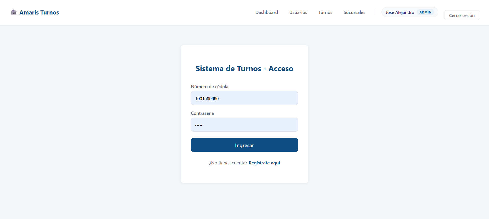
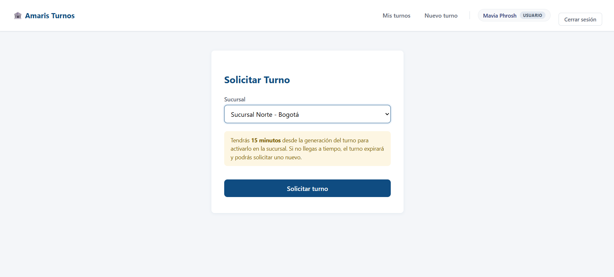
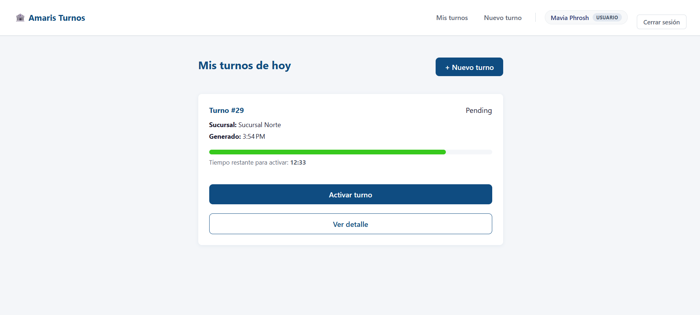
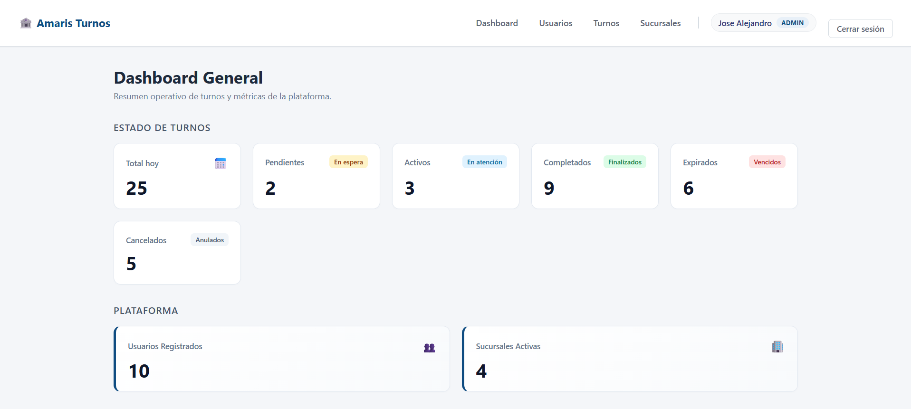
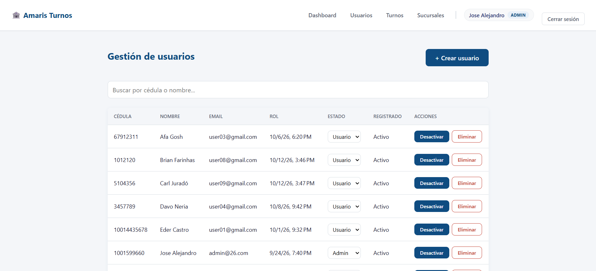
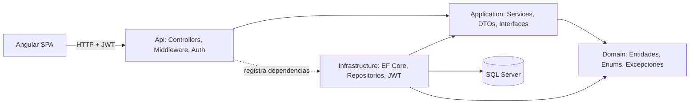
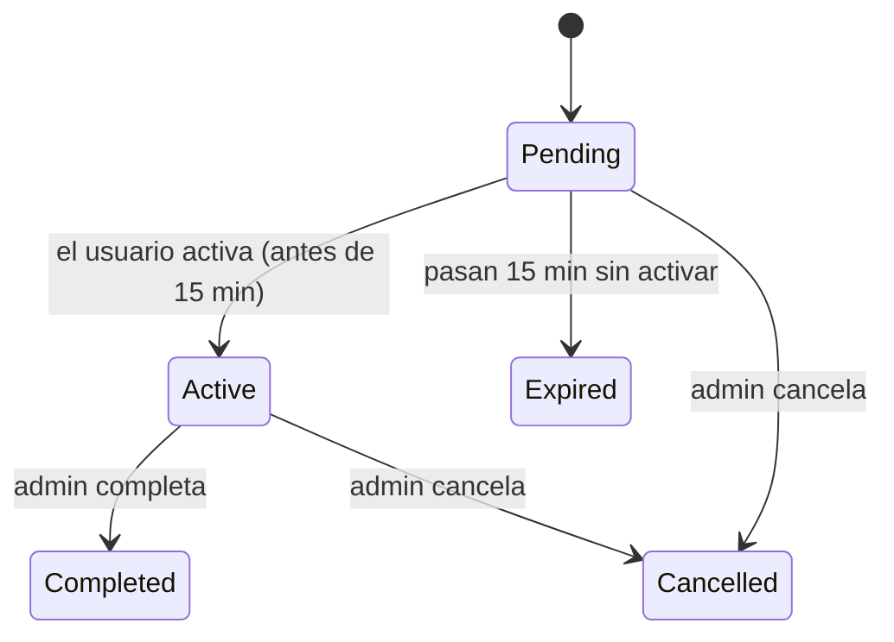
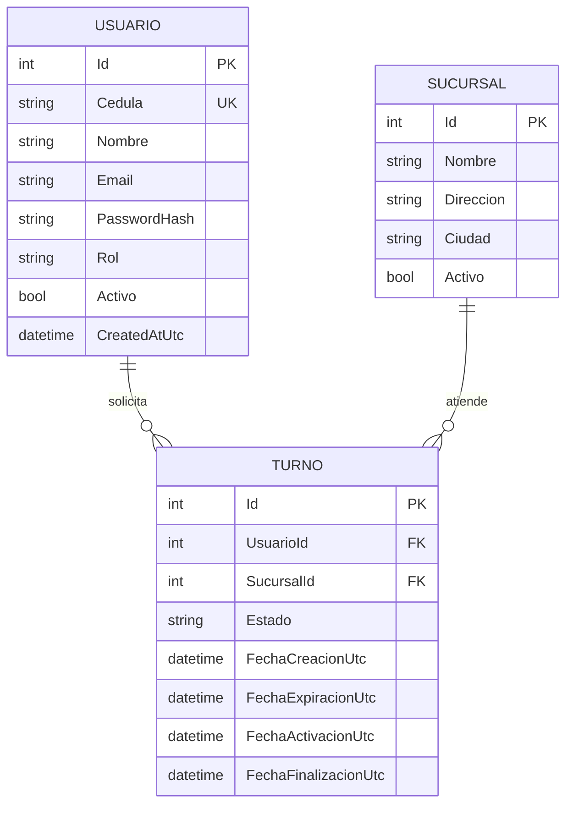

# Amaris Turnos

Sistema web de **agendamiento de turnos bancarios**. Los clientes reservan un turno en la sucursal que prefieran, 
tienen **15 minutos** para llegar y activarlo, y no pueden pedir más de **5 turnos por día**. 
Un panel administrativo permite gestionar usuarios, sucursales y turnos.
 
Proyecto de portafolio construido a partir del enunciado de una prueba técnica de desarrollo (API REST en .NET + frontend en Angular). 
Usa **.NET 10** (el enunciado original contemplaba .NET 6 a 8) y **Angular 21**.

## Tabla de contenido
 
- [Capturas](#capturas)
- [Funcionalidades](#funcionalidades)
- [Stack tecnológico](#stack-tecnológico)
- [Arquitectura](#arquitectura)
- [Modelo de datos](#modelo-de-datos)
- [Puesta en marcha](#puesta-en-marcha)
- [Pruebas](#pruebas)
- [API REST](#api-rest)
- [Decisiones técnicas](#decisiones-técnicas)
- [Seguridad](#seguridad)
- [Escalabilidad](#escalabilidad)
- [Limitaciones conocidas y próximos pasos](#limitaciones-conocidas-y-próximos-pasos)

## Capturas

### Cliente

| Login | Agendar turno |
|---|---|
|  |  |
 
| Mis turnos con cuenta regresiva |
|---|
|  |

### Administración
 
| Dashboard | Gestión de usuarios |
|---|---|
|  | 
 |
 
| Consulta de turnos con filtros |
|---|
|  |


## Funcionalidades

### Rol `Usuario` (cliente)

- Registro público con cédula, nombre y contraseña elegida por el usuario.
- Agendar un turno eligiendo sucursal. **La cédula sale de la identidad autenticada**, no se escribe en el formulario,
por lo que nadie puede pedir turnos a nombre de otra persona.
- Ver "Mis turnos de hoy" con estado, hora de generación y **cuenta regresiva** de 15 minutos con barra de progreso que cambia de color.
- Activar el turno al llegar a la sucursal.
- Aviso claro al alcanzar el límite de 5 turnos diarios.

### Rol `Admin`
 
- **Dashboard** con turnos del día por estado, usuarios registrados y sucursales activas.
- **Usuarios**: listar, buscar, crear, editar, activar/desactivar, cambiar rol y eliminar.
- **Sucursales**: crear, editar, activar/desactivar y eliminar.
- **Turnos**: consultar con filtros (fecha, sucursal, estado, cédula), **completar** turnos activos y **cancelar** turnos pendientes o activos.
- Protecciones contra auto-bloqueo: un Admin no puede desactivarse, eliminarse ni cambiarse el rol a sí mismo.


## Stack tecnológico
 
| Capa | Tecnología |
|---|---|
| Backend | C#, .NET 10, ASP.NET Core Web API |
| Acceso a datos | Entity Framework Core 10, SQL Server |
| Autenticación | JWT Bearer, contraseñas con BCrypt |
| Documentación API | Swagger / OpenAPI (Swashbuckle) |
| Pruebas backend | xUnit, Moq |
| Frontend | Angular 21 (standalone components, signals), TypeScript, Reactive Forms |
| Pruebas frontend | Vitest (runner por defecto de Angular 21) |


## Arquitectura

Arquitectura **por capas** con la dependencia apuntando siempre hacia el dominio. Se eligió frente a Clean Architecture completa para no introducir 
complejidad (MediatR, CQRS, mappers automáticos) que un proyecto de este tamaño no justifica, manteniendo la separación de responsabilidades y 
la facilidad de pruebas.



```
AmarisTurnos/
├── src/
│   ├── AmarisTurnos.Domain/          Entidades, enums y excepciones de negocio. Sin dependencias.
│   ├── AmarisTurnos.Application/     Servicios con la lógica de negocio, DTOs e interfaces.
│   ├── AmarisTurnos.Infrastructure/  DbContext, repositorios, migraciones, generación de JWT, seeder.
│   └── AmarisTurnos.Api/             Controllers, middleware de errores, autenticación, worker de expiración.
├── tests/
│   └── AmarisTurnos.Application.Tests/
└── amaris-turnos-frontend/           SPA Angular
```

- **Domain** no referencia a ningún otro proyecto: el compilador impide que dependa de EF Core o de ASP.NET.
- **Application** define las interfaces (`ITurnoRepository`, etc.) y **Infrastructure** las implementa,
lo que permite probar los servicios con repositorios simulados.
- Los **Controllers son delgados**: traducen HTTP a llamadas de servicio. Nunca devuelven entidades, siempre DTOs.
- **Repositorio específico, no genérico**: se usa solo donde aporta (testabilidad y la lógica de concurrencia de turnos).
EF Core ya implementa Unit of Work y Repository, por lo que no se envolvió con un `IRepository<T>` genérico.


### Ciclo de vida de un turno


Solo las transiciones del diagrama son válidas; el servicio rechaza cualquier otra (por ejemplo, reactivar un turno `Completed`).


## Modelo de datos


- `Usuario.Cedula` tiene **índice único**: es la identidad del cliente y el campo de login.
- Índice compuesto `(UsuarioId, FechaCreacionUtc)` en `Turno` para resolver rápido "cuántos turnos tiene este usuario hoy".
- `Rol` y `Estado` son enums en C# guardados como **texto** en la base de datos (legibles al consultar directamente).
- Las claves foráneas usan `DeleteBehavior.Restrict`: un usuario o sucursal con turnos no puede borrarse y se desactiva en su lugar, preservando el historial.

## Puesta en marcha

### Requisitos previos

- [.NET SDK 10](https://dotnet.microsoft.com/download)
- [Node.js](https://nodejs.org/) (LTS) y Angular CLI: `npm install -g @angular/cli`
- SQL Server (Developer o Express) accesible en `localhost`
- Certificado de desarrollo HTTPS de .NET: `dotnet dev-certs https --trust`

### 1. Clonar

```bash
git clone https://github.com/joseovi/amaris-turnos.git
cd AmarisTurnos
```

### 2. Configurar el backend
 
El repositorio **no incluye secretos**. Crea el archivo `src/AmarisTurnos.Api/appsettings.Development.json` (está en `.gitignore`):

```json
{
  "ConnectionStrings": {
    "DefaultConnection": "Server=localhost;Database=AmarisTurnosDb;Trusted_Connection=True;TrustServerCertificate=True;"
  },
  "Jwt": {
    "Key": "PEGA_AQUI_UNA_CLAVE_ALEATORIA_DE_AL_MENOS_32_CARACTERES"
  }
}
```

Para generar una clave segura en PowerShell:

```powershell
[Convert]::ToBase64String([System.Security.Cryptography.RandomNumberGenerator]::GetBytes(48))
```

Si tu SQL Server usa autenticación SQL o una instancia con nombre (por ejemplo `localhost\SQLEXPRESS`), ajusta la cadena de conexión.


### 3. Ejecutar el backend###

```bash
dotnet run --project src/AmarisTurnos.Api
```

En **entorno Development**, al arrancar la API:
 
1. Aplica las migraciones y crea la base de datos si no existe.
2. Crea un administrador inicial y tres sucursales de ejemplo (solo si aún no existen).
Swagger queda disponible en `https://localhost:7271/swagger`. El puerto exacto se imprime en la consola al arrancar.


### 4. Ejecutar el frontend

```bash
cd amaris-turnos-frontend
npm install
```

Verifica que `src/environments/environment.ts` apunte al puerto real de tu API:

```typescript
export const environment = {
  production: false,
  apiUrl: 'https://localhost:7271/api'
};
```
 
```bash
ng serve
```

Abre `http://localhost:4200`.


### Credenciales de demostración

| Rol | Cédula | Contraseña |
|---|---|---|
| Admin | `1000000000` | `Admin123!` |
| Usuario | Se crea desde `/registro` | La que elijas |
 
Estas credenciales provienen de `Seed:AdminCedula` y `Seed:AdminPassword` en `appsettings.json`, y el seeder **solo se ejecuta en Development**. 
Nunca debe existir una credencial conocida en producción.

## Pruebas

```bash
# Backend (xUnit + Moq)
dotnet test
 
# Frontend (Vitest)
cd amaris-turnos-frontend
ng test
```

Las pruebas del backend validan la lógica de negocio de `TurnoService` aislada de la base de datos, con repositorios simulados:
 
- Crear turno: caso correcto, sucursal inexistente y límite diario superado.
- Activar turno: caso correcto, turno vencido, turno ya activo, turno de otro usuario e inexistente.
- Consultas y expiración masiva de turnos vencidos.
Qué **no** cubren: la corrección de la transacción SQL con bloqueo (requiere una prueba de integración contra SQL Server real)
ni el comportamiento visual del frontend (requeriría pruebas end to end).

## API REST

Todas las rutas, salvo las de autenticación, requieren el header `Authorization: Bearer <token>`. La documentación interactiva está en `/swagger`.

### Autenticación

| Método | Ruta | Acceso | Descripción |
|---|---|---|---|
| POST | `/api/auth/registro` | Público | Crea una cuenta con rol `Usuario` y devuelve el token (`201`) |
| POST | `/api/auth/login` | Público | Inicia sesión con cédula y contraseña, devuelve el token |

### Turnos (usuario autenticado)

| Método | Ruta | Descripción |
|---|---|---|
| POST | `/api/turnos` | Crea un turno. Body: `{ "sucursalId": 1 }`. La cédula se toma del token (`201`) |
| GET | `/api/turnos/mios` | Turnos del día del usuario autenticado |
| GET | `/api/turnos/{id}` | Detalle de un turno |
| PATCH | `/api/turnos/{id}/activar` | Activa un turno propio vigente |

### Sucursales

| Método | Ruta | Acceso | Descripción |
|---|---|---|---|
| GET | `/api/sucursales` | Autenticado | Lista sucursales |
| POST | `/api/sucursales` | Admin | Crea una sucursal |
| PUT | `/api/sucursales/{id}` | Admin | Edita una sucursal |
| PATCH | `/api/sucursales/{id}/estado` | Admin | Activa o desactiva |
| DELETE | `/api/sucursales/{id}` | Admin | Elimina (falla si tiene turnos) |

### Administración

| Método | Ruta | Descripción |
|---|---|---|
| GET | `/api/admin/dashboard` | Métricas del día |
| GET | `/api/admin/turnos` | Lista con filtros: `fecha`, `sucursalId`, `estado`, `cedula` |
| PATCH | `/api/admin/turnos/{id}/completar` | `Active` pasa a `Completed` |
| PATCH | `/api/admin/turnos/{id}/cancelar` | `Pending` o `Active` pasa a `Cancelled` |
| GET | `/api/admin/usuarios` | Lista usuarios, filtro opcional `busqueda` |
| GET | `/api/admin/usuarios/{id}` | Detalle |
| POST | `/api/admin/usuarios` | Crea un usuario con el rol indicado |
| PUT | `/api/admin/usuarios/{id}` | Edita nombre y email |
| PATCH | `/api/admin/usuarios/{id}/estado` | Activa o desactiva |
| PATCH | `/api/admin/usuarios/{id}/rol` | Cambia el rol |
| DELETE | `/api/admin/usuarios/{id}` | Elimina (falla si tiene turnos) |

Todo el bloque `/api/admin/*` está protegido con `[Authorize(Roles = "Admin")]`.

### Códigos de respuesta

| Código | Cuándo |
|---|---|
| `200` / `201` / `204` | Éxito (consulta o acción / creación / eliminación) |
| `400` | Regla de negocio incumplida o datos inválidos. Cuerpo: `{ "error": "mensaje" }` |
| `401` | Sin token o token inválido o expirado |
| `403` | Autenticado pero sin el rol requerido |
| `500` | Error inesperado. Mensaje genérico; el detalle solo se registra en el servidor |

## Decisiones técnicas

**La identidad viene del token, nunca del cliente.** 
Los endpoints de usuario no reciben "de quién" son los datos. `GET /api/turnos/mios` y `POST /api/turnos` 
leen el identificador del claim `NameIdentifier` del JWT ya verificado. Cambiar un ID en la URL no permite ver datos ajenos 
porque ese ID no se usa para decidir la pertenencia. Donde sí hay un ID en la ruta (`/activar`), el servicio verifica que el turno 
pertenezca al usuario antes de cualquier cambio.

**Concurrencia en el límite de 5 turnos.** Validar "contar y luego insertar" tiene una condición de carrera: 
dos peticiones simultáneas pueden leer 4 y crear dos turnos. Se resuelve en `TurnoRepository` con una transacción y una lectura con 
`WITH (UPDLOCK, HOLDLOCK)`, de modo que la segunda petición espera a que la primera confirme. El punto de verdad es la base de datos y no la memoria del proceso, 
así que funciona con varias instancias de la API (un `lock` en memoria no lo haría).

**Fechas en UTC.** Todo se guarda en UTC. SQL Server no conserva el `Kind` de un `datetime2`, así que un convertidor global en el `DbContext` marca como UTC todo 
`DateTime` leído; sin él, el JSON sale sin la `Z` y el navegador interpreta la hora como local. La conversión a hora local ocurre solo al mostrar, 
con el pipe `date` de Angular.

**Expiración de turnos en dos capas.**

1. Un `BackgroundService` (`TurnoExpiracionWorker`) ejecuta cada 60 segundos (configurable con `Turnos:IntervaloExpiracionSegundos`)
un único `UPDATE` masivo con `ExecuteUpdateAsync` sobre los turnos `Pending` vencidos. Es idempotente, por lo que dos instancias corriendo a la vez no causan daño.

2. `ActivarTurnoAsync` revalida la expiración al instante, cerrando el margen de hasta 60 segundos entre ciclos del worker.

**Dos validaciones para unicidad.** La cédula se verifica antes de insertar (mensaje inmediato) y además existe el índice único en base de datos como 
garantía final; si la carrera ocurre, la excepción de base de datos se traduce a un error de negocio claro.

**Errores de negocio con una excepción propia.** `ReglaDeNegocioException` se captura en un middleware central y se traduce a `400` con el mensaje. 
Los errores inesperados devuelven un mensaje genérico y el detalle solo va al log, para no filtrar información interna.

**Desactivar antes que eliminar.** Usuarios y sucursales tienen `Activo`. El borrado físico solo procede si no hay turnos asociados, preservando el historial.

*Sin AutoMapper ni MediatR.** El mapeo manual es explícito y fácil de depurar a esta escala. Cada patrón se incorporó solo donde resolvía un problema real.

**Frontend.** Componentes standalone con carga diferida por ruta, estado con signals, Reactive Forms, un interceptor que adjunta el token y dos guards componibles:
`authGuard` (¿hay sesión?) y `roleGuard` (¿el rol coincide con `data.rolesPermitidos` de la ruta?).

## Seguridad

- Contraseñas con **BCrypt** (hash con sal), nunca en texto plano.
- JWT firmado con HMAC-SHA256, validando emisor, audiencia y expiración, sin tolerancia de reloj (`ClockSkew = 0`).
- El mensaje de login fallido es el mismo para "usuario inexistente" y "contraseña incorrecta", evitando la enumeración de usuarios.
- **Sin mass assignment**: el DTO de registro público no tiene campo de rol, así que nadie puede autoasignarse `Admin`.
- Autorización real en el backend con `[Authorize(Roles = "Admin")]`; los guards de Angular son solo experiencia de usuario.
- CORS restringido al origen del frontend, no `AllowAnyOrigin`.
- Consultas parametrizadas (`FromSqlInterpolated`), sin concatenar SQL.
- La clave JWT y la cadena de conexión no están en el repositorio.

## Escalabilidad

- **API sin estado**: la sesión viaja en el JWT, así que se pueden levantar varias instancias detrás de un balanceador sin sesiones compartidas.
- **Concurrencia resuelta en la base de datos**, no en memoria (ver decisiones técnicas).
- **Worker idempotente**: puede correr en varias instancias sin duplicar efectos.
- Índices diseñados para las consultas más frecuentes y agregados del dashboard con un solo `GROUP BY`.
- Lógica asíncrona de extremo a extremo con `CancellationToken`.

## Limitaciones conocidas y próximos pasos

Se listan a propósito; conocer los límites del sistema es parte del diseño.
 
- **El "día" del límite de 5 turnos se calcula en UTC**, no en la zona horaria local. En Colombia (UTC-5) el contador diario se reinicia a las 7:00 p. m.
Una mejora es parametrizar la zona horaria del negocio.
- **El token se guarda en `localStorage`**, expuesto a XSS. La alternativa más segura es una cookie `httpOnly`, que exige ajustar CORS y protección CSRF.
- Sin **refresh tokens**: al expirar el JWT hay que volver a iniciar sesión.
- Sin **límite de intentos de login** (rate limiting).
- Los errores de negocio, incluido "recurso no encontrado", responden `400`; distinguir `404` y `409` sería más preciso.
- El origen CORS (`http://localhost:4200`) está fijo en código; en un despliegue real debe venir de configuración.
- No hay pruebas de integración contra SQL Server real ni pruebas end to end.
- Faltan Docker Compose y un pipeline de CI para levantar y validar todo con un comando.
- En producción las migraciones deben aplicarse desde el pipeline de despliegue, no al arrancar la aplicación.

## Autor
 
**José Alejandro** · [@joseovi](https://github.com/joseovi)
